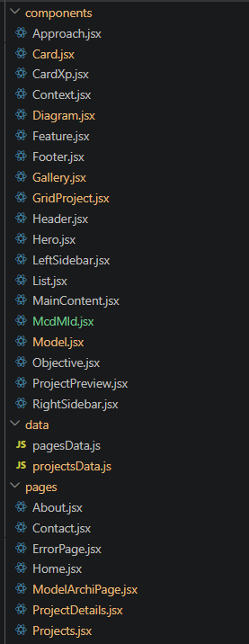
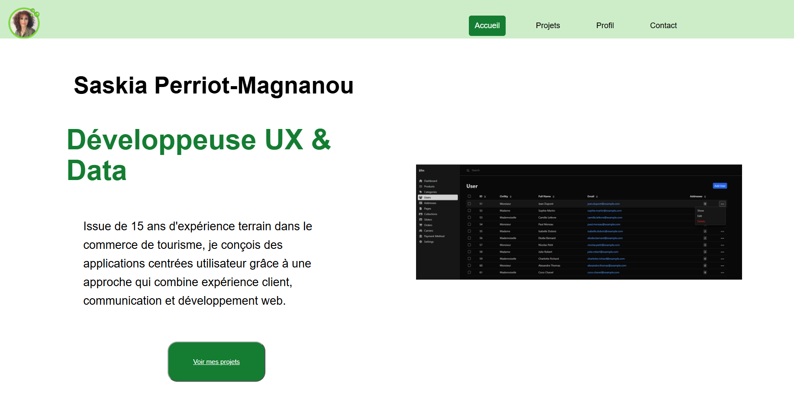
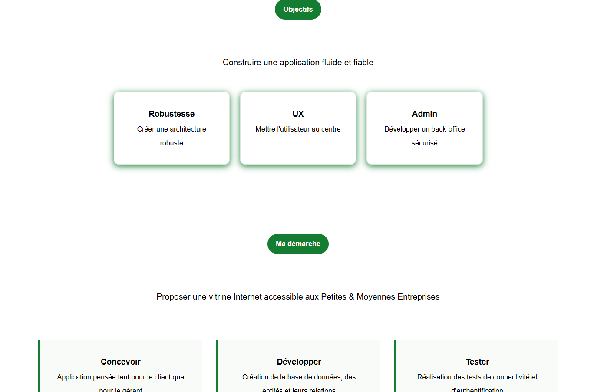
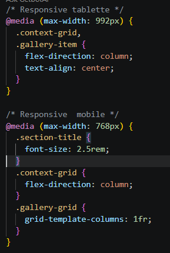

<!DOCTYPE html>
<html>
<head>
    <meta charset="utf-8">
</head>

<body>

<!-- 

 -->

~~~~~~~~~~~~~~~~~~~~~~~~~~~~~~~~~~~~~~~~~~~~~~~~~~~~~~~~~~~~~~~~~~~~~~~~~~~~~~~~~~~~~~~~~~~~

  <h1 align="center">
    &#128188; Portfolio React  
    Développeuse Web • Data • UX
  </h1>

~~~~~~~~~~~~~~~~~~~~~~~~~~~~~~~~~~~~~~~~~~~~~~~~~~~~~~~~~~~~~~~~~~~~~~~~~~~~~~~~~~~~~~~~~~~~
    

Portfolio développé avec **React** afin de présenter mon parcours, mes compétences et plusieurs études de cas réalisées durant ma formation et mes projets personnels.

L'objectif n'était pas uniquement de créer une vitrine, mais de concevoir une application React maintenable, organisée autour de composants réutilisables et d'une architecture évolutive.

    
  <h2>&#128270;Apperçu</h2>
    
Le portfolio comprend :

      <ul>
        <li>Une page d'accueil présentant mon profil</li>
        <li>Une page « À propos » retraçant mon parcours</li>
        <li>Une galerie de projets</li>
        <li>Une page de contact</li>
        <li>Une page détaillée pour chaque projet sous forme de mini étude de cas</li>
      </ul>
    
Chaque projet présente notamment :

        <ul>
          <li>le contexte</li>
          <li>les objectifs</li>
          <li>la démarche suivie</li>
          <li>les fonctionnalités développées</li>
          <li>une galerie de captures d'écran</li>
        </ul>
    
Mon projet fil rouge comprend également :

        <ul>
          <li>les diagrammes UML</li>
          <li>les modèles de données</li>
          <li>les maquettes interactives</li>
        </ul>

  <h2>&#128296;Technologies utilisées</h2>
    <h3>Front-end</h3>
      <ul>
          <li>React</li>
          <li>React Router</li>
          <li>JavaScript ES6+</li>
          <li>CSS3 (Flexbox & Grid)</li>
          <li>React Icons</li>
        </ul>
    <h3>Outils</h3>
      <ul>
          <li>Git</li>
          <li>GitHub</li>
          <li>VS Code</li>
          <li>Figma (maquettes)</li>
          <li>StarUml (diagrammes UML)</li>
        </ul>

  <h2>&#128194;Architecture</h2>
    src/  
    │  
    ├── assets/  
    ├── components/  
    │   ├── Hero  
    │   ├── Header  
    │   ├── Footer  
    │   ├── MainContent  
    │   ├── ProjectPreview  
    │   ├── Context  
    │   ├── Objectives  
    │   ├── Approach  
    │   ├── Feature  
    │   ├── McdMld  
    │   ├── Diagram  
    │   ├── Model  
    │   └── Gallery  
    │  
    ├── data/  
    │   ├── pagesData.js  
    │   └── projectsData.js  
    │  
    ├── pages/  
    │   ├── HomePage  
    │   ├── ProjectsPage  
    │   ├── ProjectDetailsPage  
    │   ├── AboutPage  
    │   ├── ContactPage  
    │   └── ErrorPage  
    │  
    └── App.jsx  

  <h2>&#128161;Choix techniques</h2>
    
Le contenu du portfolio est entièrement piloté par les fichiers :

        <ul>
          <li>pagesData.js</li>
          <li>projectsData.js</li>
        </ul>
    
Cette approche permet :

        <ul>
          <li>de séparer les données de l'affichage ;</li>
          <li>de réutiliser les mêmes composants sur plusieurs pages ;</li>
          <li>d'ajouter un nouveau projet sans modifier les composants React.</li>
        </ul>
    
Chaque page projet est ainsi générée automatiquement à partir des données.

  <h2>&#129535;Principes de développement</h2>
    
Lors de ce projet, une attention particulière a été portée à :

        <ul>
          <li>la réutilisation des composants ;</li>
          <li>la séparation des responsabilités ;</li>
          <li>la lisibilité du code ;</li>
          <li>la maintenabilité ;</li>
          <li>le responsive design ;</li>
          <li>l'expérience utilisateur (UX).</li>
        </ul>

   <h2>&#128242;Responsive Design</h2>
    
Lors de ce projet, une attention particulière a été portée à :

        <ul>
          <li>Desktop</li>
          <li>Tablette</li>
          <li>Mobile</li>
        </ul>

  <h2>&#128223;Quelques fonctionnalités</h2>
    <ul>
      <li>Navigation via React Router</li>
      <li>Hero dynamique</li>
      <li>Pages générées depuis des données JavaScript</li>
      <li>Cartes de projets réutilisables</li>
      <li>Galerie d'images responsive</li>
      <li>Présentation des projets sous forme d'étude de cas</li>
      <li>Icônes React Icons</li>
      <li>Composants entièrement réutilisables</li>
    </ul>

  <h2>&#128248;Apperçu</h2>
  
Page d'accueil

    

  <h2>&#128260;Perspectives d'évolution</h2>
    
Plusieurs améliorations sont prévues :

      <ul>
        <li>animation des transitions</li>
        <li>mode sombre</li>
        <li>filtres par technologie</li>
        <li>moteur de recherche des projets</li>
        <li>formulaire de contact connecté à un service d'envoi d'e-mails</li>
        <li>internationalisation (FR / EN)</li>
      </ul>

  <h2>&#128105;A propos</h2>
    
Après plus de vingt ans d'expérience dans le commerce, la restauration et la communication, j'ai choisi de me reconvertir dans le développement d'applications web.

    
Mon parcours me permet aujourd'hui de combiner :

      <ul>
        <li>l'écoute des besoins utilisateurs ;</li>
        <li>l'expérience client ;</li>
        <li>le marketing ;</li>
        <li>l'analyse de données ;</li>
        <li>le développement web.</li>
      </ul>

  <h2>&#128231;Contact</h2>
    
N'hésitez pas à me contacter via le formulaire du portfolio ou sur LinkedIn.

    
Merci pour votre visite !

</body>
</html>
